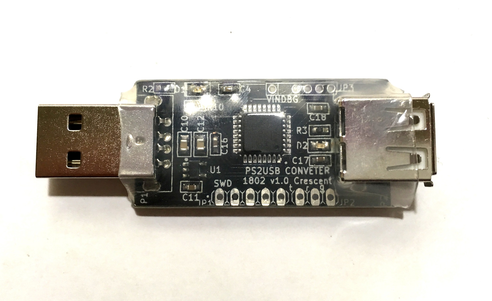
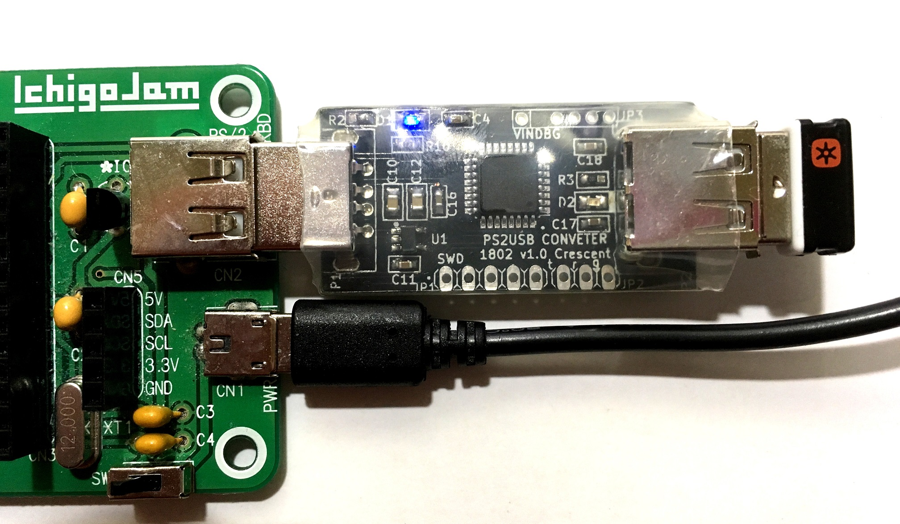
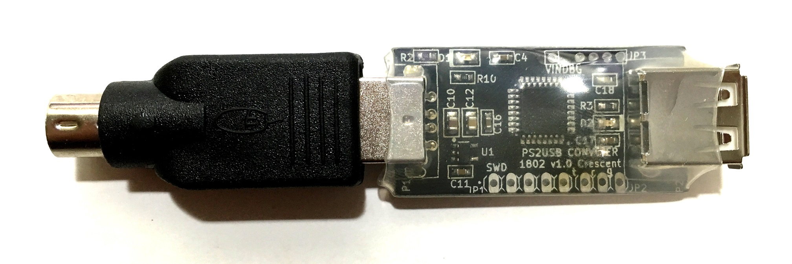

# PS/2 USB逆変換アダプタ
Description of PS/2USB_CONVERTER. 

## 概要
PS/2 USB逆変換アダプタはUSBキーボードをPS/2化する変換アダプタです。  
標準ドライバで動作可能なUSBキーボードをPS/2キーボードとして使用できるように変換します。  
世の中で販売されている変換アダプタとは変換の向きが逆です。  

【市販USBキーボード】<-USB->【PS/2 USB逆変換アダプタ】<-PS/2->【Old PC with PS/2 IF】

プログラミング専用こどもパソコンichigojamやサーバマシンなどのPS/2キーボードのみをサポートしている場合にPS/2 USB逆変換アダプタを使用して、USBキーボードをPS/2化します。

## Ichigojamで使用する場合
IchigoJam Tの場合はそのままキーボード用のUSB端子へPS/2 USB逆変換アダプタを接続してください。  
IchigoJam Uと初代プリント基板の場合は同梱のUSB端子PS/2変換器を介して接続してください。  

## 一般的なコンピュータで使用する場合  
同梱のUSB端子PS/2変換器を介して接続してください。

## 注意
  * USBキーボードをPS/2規格に変換しているため、すべての機器やキー入力を保証することはできません。  
  * すべての機器で対応することを保証できません。  
  * 音量調整やメールボタンといったキーボード固有の機能は使用できません。
  * Logicool製日本語、英語キーボードで動作確認しましたが、すべてのUSBキーボードの動作保証はできません。
  * 日本語、英語以外の言語のキーボードでは入力できないキーがある場合があります。
  * PS/2規格に変換しているため、キーレスポンスやキーリピート等の挙動がUSBで接続する場合と多少異なります。
  * PS/2キーボードとPS/2マウス兼用ポートに接続した場合、不具合が発生する場合はあります。変換ケーブル等でキーボードとマウスを分離して接続してください。
  * USBハブを介した接続には対応していません。直接キーボードのUSBを接続してください。
  * キーレスポンスが遅延する場合は電源投入時リセットに失敗している可能性があります。キーボードのUSBを接続した状態で再度、当該アダプタを抜き差ししてください。  
  * USBマウスとPS/2との変換に非公式で対応しています（コンポジットデバイスでなく、マウスデバイス単体として認識されるマウスのみ対応）    

## 告知
  * 使用ICの価格高騰や入手性を考慮し、STM32+VNC2-32ベース(V1)からPIC32MXベース(V2)に移行しました(22年3月)
  * 使用ICの価格高騰や入手性を考慮し、PIC32MXベース(V2)からWCH CH554ベースに移行予定です(26年秋予定)
  * 移行前の製品と移行後の製品で基本機能は同じですが、キーレスポンス等異なる場合があります  ご了承ください 
  * 上記写真は移行前につき、移行後の製品は若干基板実装部品等異なります  
  * 同梱のPS/2変換器の色や形状、LED色等の仕様を告知なしに変更する場合があります  
  
 ## 販売サイト
  * [スイッチサイエンス][1]
  * [家電のケンちゃん][2]
  * [PCN][3]

## Overview
The PS/2 USB Conversion Adapter is a conversion adapter that converts a USB keyboard to a PS/2 keyboard.  
It converts a USB keyboard that works with standard drivers so that it can be used as a PS/2 keyboard.  
The conversion direction is reversed compared to other conversion adapters sold on the market.  

[Commercial USB Keyboard] <-USB-> [PS/2 USB Conversion Adapter] <-PS/2-> [Old PC with PS/2 IF]

Use the PS/2 USB Conversion Adapter to convert a USB keyboard to PS/2 when the system only supports PS/2 keyboards, such as with the IchigoJam programming computer or server machines.

## Using with IchigoJam
For IchigoJam T, simply connect the PS/2 USB Conversion Adapter to the USB port for the keyboard.  
For IchigoJam U and the original printed circuit board, please connect via the included USB-to-PS/2 converter.  

## When using with a general computer
Please connect via the included USB-to-PS/2 converter.

## Notes
* Because the USB keyboard is converted to the PS/2 standard, we cannot guarantee compatibility with all devices or key inputs.  
* We cannot guarantee compatibility with all devices.  
* Keyboard-specific functions such as volume control and mail buttons cannot be used.  
* We have confirmed operation with Logitech Japanese and English keyboards, but we cannot guarantee operation with all USB keyboards.  
* Some keys may not work with keyboards in languages ​​other than Japanese and English.  
* Because it uses a PS/2 standard conversion, key response and key repeat behavior may differ slightly from when connected via USB.  
* Problems may occur when connecting to a PS/2 keyboard and mouse combined port. Please connect the keyboard and mouse separately using a split cable.  
* Connection via a USB hub is not supported. Please connect the keyboard's USB directly.  
* If key response is delayed, the power-on reset may have failed. Please unplug and replug the adapter while the keyboard's USB is connected.  
* Unofficially supports conversion between USB mice and PS/2 (only mice recognized as standalone mouse devices, not composite devices, are supported).

## Notice
* Due to rising prices and availability of ICs, we have migrated from STM32+VNC2-32 base (V1) to PIC32MX base (V2) (March 2022).  
* Due to rising prices and availability of ICs, we plan to migrate from PIC32MX base (V2) to WCH CH554 base (scheduled for Autumn 2026).  
* While the basic functions are the same for both pre- and post-migration products, key response and other aspects may differ. Please understand.  
* The above photo is from the pre-migration version; the post-migration product will have slightly different components on the circuit board.  
* The color, shape, LED color, and other specifications of the included PS/2 converter may be changed without notice.  
  
[1]: https://www.switch-science.com/products/3785
[2]: https://www.kadenken.com/view/item/000000000767
[3]: https://hello002.stores.jp/items/5bce8ce05f78661b790000ce
